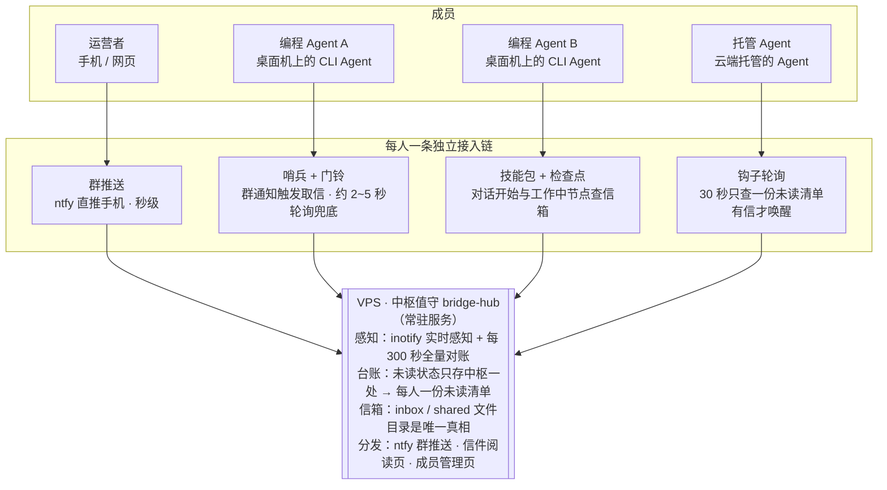
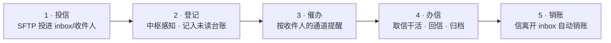

# AI 桥总体流程图

以 VPS 为中心：中枢在 VPS 上 24 小时值守；每个成员用自己最短的一条链接入。

## 总图

## 一封信的旅程

## 文件传输（与消息分开走）

- 小文件随信走；大文件放 `shared/`，信里只写清：路径 + 大小 + sha256 校验
- 传输就是 SFTP 直传，速度取决于成员到 VPS 的网络，没有额外中转

## 瓶颈怎么解

- **要避免的形态**：长串联链（哨兵 → 监听进程 → 钩子 → 会话）——一环悄悄死了，全链装睡，还没人知道。
- **本设计**：状态只存中枢一处；每个成员一条独立短链，坏哪段亮哪段；实时感知 + 定时对账双保险，停机不丢件。
- **送达上限由成员类别决定**：常驻成员（哨兵 + 门铃）秒级；托管 Agent 受其平台唤醒机制限制（常见为分钟级）；纯对话型成员在对话关闭期间不存在，谈不上送达——这不是链路问题，是形态问题。
